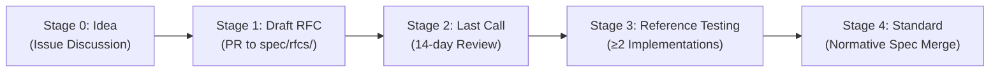

# HLN Protocol Specification Governance

This document establishes the formal open-source governance model, decision-making processes, role definitions, and normative advancement criteria for the **Holarchical Logic Network (HLN)** specification and associated standards.

---

## 1. Principles

The HLN specification is governed according to four core principles:

1.  **Openness & Transparency:** All proposals, debates, architectural reviews, and decisions are conducted publicly in the repository issue tracker and discussion forums.
2.  **Vendor Neutrality:** The specification does not favor any commercial entity, cloud provider, hardware vendor, or runtime framework. Interfaces and protocols are transport-neutral and programming-language-agnostic.
3.  **Rough Consensus and Running Code:** Consistent with the IETF philosophy (RFC 7282), specification amendments require both broad community consensus and demonstrated, interoperable reference implementations before normative status is granted.
4.  **Specification-Code Parity:** No feature may be merged into normative specification documents without verified JSON Schemas, OpenAPI descriptions, and golden test vectors.

---

## 2. Governance Structure & Roles

### 2.1. Contributors
Any individual or entity who files an issue, submits an RFC proposal, corrects documentation, or contributes code/schemas under the project's dual license.

### 2.2. Committers
Contributors who have demonstrated ongoing technical competence and sustained contribution to the specification and test suites. Committers receive repository write access and can review/approve Pull Requests.

### 2.3. Technical Steering Committee (TSC)
The governing body responsible for protocol architecture, security oversight, conformance profiles, and final ratification of normative specification releases.
*   **Decisions:** Decisions are made by rough consensus. When a formal vote is required, each TSC member holds one vote, with a two-thirds majority required for approval.
*   **Charter:** Maintaining [SPECIFICATION.md](spec/SPECIFICATION.md), [conformance.md](spec/conformance.md), [SECURITY.md](SECURITY.md), and [schemas/](schemas/).

---

## 3. RFC (Request for Comments) Specification Process

All normative changes to the HLN protocol follow a formal five-stage lifecycle:

1.  **Stage 0: Idea Formulation:** Discussion initiated via a GitHub Issue outlining the problem statement, prior art comparison, and proposed protocol delta.
2.  **Stage 1: Draft RFC:** Author submits a pull request containing a markdown document in `spec/rfcs/`, including:
    *   Motivation, use cases, and architectural rationale.
    *   Formal JSON Schema draft.
    *   OpenAPI path/component definitions (if applicable).
    *   STRIDE security analysis and backwards compatibility assessment.
3.  **Stage 2: Working Group Review & Last Call:** The proposal undergoes technical review by Committers and the TSC. Once major design questions are resolved, the proposal enters a mandatory **14-day Public Last Call** period.
4.  **Stage 3: Reference Implementation & Conformance:** The proposed protocol changes are implemented in at least two independent runtimes. Golden test vectors are produced and validated.
5.  **Stage 4: Final Ratification & Standard Merge:** Upon passing the conformance criterion (§4), the RFC is marked `Approved` and merged into the normative specification chapters in `spec/`.

---

## 4. Conformance Criterion for Normative Specification Status

To protect developers, enterprises, and standardizing bodies from premature or single-vendor lock-in, the HLN project enforces the **Two-Implementation Rule**:

> [!IMPORTANT]
> **Normative Elevation Requirement:**
> No protocol primitive, message model, decider semantics, or security mechanism may be elevated from `Experimental / Draft` to `Normative Standard` without meeting all of the following requirements:
> 1.  **At least two independent, interoperable implementations** (e.g. `holarchy` in Python and an independent reference worker or runtime in Rust, Go, or TypeScript) have implemented the full specification.
> 2.  Both implementations achieve **100% pass rate** on the normative conformance test-suite (`conformance/test-vectors/`), verifying RFC 8785 Canonical JSON, HMAC/Ed25519 envelope signatures, and D-DNA hash chains.
> 3.  The feature is fully covered in machine-readable JSON Schema (Draft 2020-12) and OpenAPI 3.1.0 specifications.

---

## 5. Intellectual Property Rights (IPR) & Antitrust Compliance

*   **Licensing:** All documentation is licensed under CC BY 4.0; all schemas, APIs, and code are licensed under Apache 2.0.
*   **Patent Grant:** By contributing to HLN, contributors grant a perpetual, worldwide, royalty-free patent license covering patent claims necessarily infringed by their contributions, per Section 3 of the Apache License 2.0.
*   **Antitrust Policy:** Participants agree to abide by antitrust and competition laws. Working group meetings and discussions must never involve pricing, market allocation, or collective boycotts.
