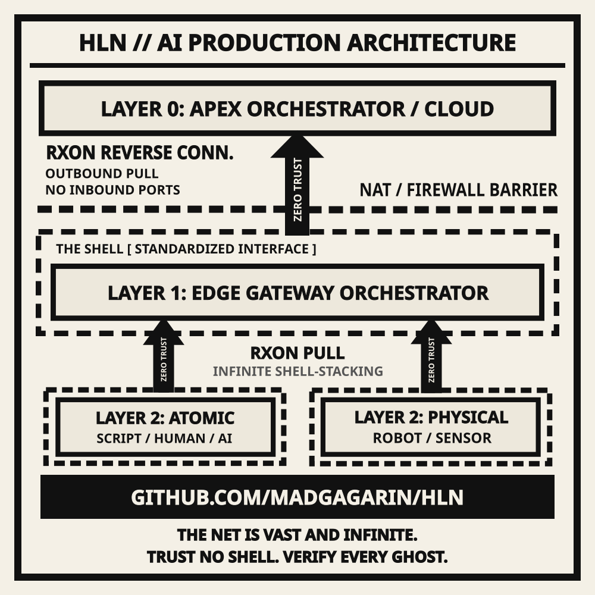

# HLN: Holarchical Logic Network

  

  
  
  

**HLN (Holarchical Logic Network)** is an architectural standard and network protocol designed to orchestrate autonomous, distributed agents in a cryptographically secure, predictable, and scalable manner.

Unlike unstructured peer-to-peer agent swarms where emergent communication leads to cascading execution and non-deterministic failures, HLN enforces a structured **Holarchy** (a hierarchy of autonomous units). It coordinates non-deterministic AI agents and deterministic software systems through verifiable finite-state blueprints.

---

## Key Principles

### 1. The Holon (Ghost-in-the-Shell)
The fundamental atomic unit of HLN is the **Holon**. Every Holon decouples execution logic from network contracts:
* **The Ghost**: The internal decision logic (an LLM agent, a deterministic script, a robotic controller, or a human expert).
* **The Shell**: A standardized, strictly typed network interface that connects the Ghost to the network via the **RXON** protocol.

Combining them produces a self-contained building block that can be nested recursively (**Matryoshka Principle**).

### 2. RXON (Reverse Axon Protocol)
The communication backbone of HLN. Communication in HLN follows a strictly **Worker-Initiated (Pull)** model. The superior orchestrator **never** initiates connections to subordinate workers. Instead, the subordinate Shell initiates the connection upward:
* **Bottom-Up Initiative**: Workers connect upstream to claim tasks and stream results.
* **Zero Exposed Attack Surface**: Execution nodes operate securely behind NATs, corporate firewalls, or on edge IoT devices with no open inbound ports.
* **Dual-Profile Zero Trust**: Support for verifiable provenance chains (`provenance_chain`) and envelope integrity verification across arbitrary nesting layers.

### 3. Shell-Stacked Holarchy (Fractal Composition)
HLN builds **Holarchies**, not rigid centralized monoliths:
* **Fractal Isomorphism**: A complex cluster of sub-orchestrators and workers can be encased within a single Shell to present the exact same worker interface to a higher-level orchestrator.
* **Bounded Recursion**: Nesting is configurable to arbitrary depths while strictly bounded by protocol limiters (`max_holarchy_depth`, default: 10) to eliminate runaway execution loops.

### 4. Directional Resource & Skill Matching
HLN abstracts compute capacity, models, and domain skills as standardized intents:
* **Universal Semantics**: Any device (GPU, NPU, Sensor, Actuator) or skill capability is matched using directional operators (`min`, `max`, `eq`, `in`, `contains_all`).
* **Safe Allocation**: Hardware requirements enforce minimum capacity floors (CPU, RAM, VRAM), pricing and latency specify maximum ceilings, and skill capabilities require strict superset compliance.

---

## Documentation Structure

### Normative Standards (`spec/`)
Normative documents define the requirements that compliant implementations **MUST** satisfy (following RFC 2119 / RFC 8174 keywords):

* [**Technical Specification**](spec/SPECIFICATION.md): Core protocol, data models, state transitions, and wire-level contracts.
* [**RXON Protocol**](spec/rxon-v1.1.md): Version range negotiation, skill namespaces, SemVer build metadata, schema compatibility, and `BlobReference` CAS offloading.
* [**HoloReg CAS & Merkle DAG Registry**](spec/registry-cas.md): OCI v1.1 CAS storage, relational Merkle DAG index, upload sessions, SemVer Gate, Referrers API, cluster leases & GC.
* [**HLN Manifest & Bundling**](spec/manifest-and-bundling.md): Project manifest `hln.toml`, lockfile `hln.lock`, `CanonicalManifest`, and deterministic `.tar.zst` bundling.
* [**HoloNode Worker Runtime**](spec/worker-runtime.md): Dynamic skill mounting via `mounter.py`, `uv venv` sub-workers over Unix Domain Sockets, pull-based skill synchronization via Heartbeat, SLSA/SBOM verification.
* [**Holarchy Orchestrator Topology**](spec/orchestrator-topology.md): `TopologyManager`, compiled `graph.rxon.json` execution without raw Python evaluation on Control Plane, worker groups `[topology.groups]`, federated `[topology.external]` holons.
* [**Blueprint & FSM Specification**](spec/blueprint.md): Declarative workflow topology, deciders, conditional steps, and DAG coordination.
* [**Canonical JSON (RFC 8785 / JCS)**](spec/canonical-json.md): Deterministic serialization rules for cryptographic signing and hashing.
* [**Lifecycle & FSM Statuses**](spec/lifecycle-and-status.md): Task and job lifecycle states, transitions, timeouts, and quarantine semantics.
* [**Conformance Profiles**](spec/conformance.md): Specification of Profile `L1-Baseline` (HMAC + TLS) and Profile `L2-Hardened` (Ed25519/JWS + mTLS + STS).
* [**Distributed Tracing Protocol**](spec/observability-protocol.md): End-to-end W3C trace context propagation across orchestrators and workers.

### Informative Deep Dives & Guides (`concepts/`, `docs/`)
* [**HLN Manifesto**](MANIFESTO.md): Philosophical foundations and the case for deterministic agent orchestration.
* [**Terminology & Glossary**](GLOSSARY.md): Formal terms and standard definitions used across HLN specifications.
* [**Worker Protocol Reference**](docs/worker_protocol_reference.md): Practical HTTP wire format reference for worker registration, task long-polling, and heartbeats.
* [**Prior Art & Lineage**](docs/PRIOR_ART.md): Scholarly foundations (Koestler 1967, PROSA 1998, Beer VSM 1972, OTP 1996, Temporal) and HLN's specific delta.
* [**Holarchy & Shell-Stacking**](concepts/HOLARCHY_MANIFESTO.md): Conceptual deep dive into recursive composition.
* [**Security Extensions**](concepts/SECURITY_EXTENSIONS.md): Policy enforcement points, bounded recursion, and tamper-evident audit.
* [**Reactive HLN**](concepts/REACTIVE_HLN.md): Worker-initiated event signaling, credit-based backpressure, and bubbling.
* [**Physical Holons**](concepts/PHYSICAL_HOLONS.md): Extending the grid to robotics, cyber-physical devices, and IoT.
* [**Pluggable Transports**](concepts/PLUGGABLE_TRANSPORTS.md): Decoupling the protocol from HTTP/WS across alternative transports.

### Machine-Readable Schemas & APIs
* [**OpenAPI 3.1 Definition**](api/openapi.yaml): Machine-readable HTTP API contract for orchestrators and registries (32 operations across 31 paths).
* [**JSON Schemas**](schemas/): Draft 2020-12 schemas for all 19 core protocol and manifest data models.
* [**Conformance Test Vectors**](conformance/test-vectors/): Byte-level test vectors for RFC 8785 canonicalization, task signing, and D-DNA.

---

## Reference Implementations

The ecosystem consists of 5 modular reference packages:

* [**rxon**](https://github.com/madgagarin/RXON): Core protocol serialization, types, schema validation (`is_schema_compatible`), cryptographic signing, and HTTP/WS transport bindings.
* [**holoreg**](https://github.com/madgagarin/holoreg): Centralized OCI v1.1 CAS storage (`blobs/sha256/`) and relational Merkle DAG registry with SemVer Gate, Referrers API, and cluster leases.
* [**holarchy-cli** (`hln` / `holarch`)](https://github.com/madgagarin/holarchy-cli): Developer CLI tool and client SDK featuring deterministic `.tar.zst` bundling, `hln.lock` resolution, and type stub generation.
* [**holonode**](https://github.com/madgagarin/holonode): Dynamic worker runtime featuring `uv venv` sub-worker isolation over Unix Domain Sockets, CAS bundle mounting, exponential backoff with jitter, WRR multi-orchestrator polling, and live HUD telemetry.
* [**holarchy**](https://github.com/madgagarin/holarchy): Production-grade control plane orchestrator featuring `TopologyManager`, compiled `graph.rxon.json` execution, FSM transitions, advisory deciders, Redis storage backends, and Zero-Trust verification.

---

## Contributing

We welcome contributions, RFC proposals, and feedback! Please review [**CONTRIBUTING.md**](CONTRIBUTING.md) and [**GOVERNANCE.md**](GOVERNANCE.md) for details on our specification revision process.

## License

* Specification text and documentation are licensed under the [Creative Commons Attribution 4.0 International (CC BY 4.0)](LICENSE).
* Machine-readable schemas, API definitions, test vectors, and sample code are licensed under the [Apache License, Version 2.0](LICENSE-CODE).
