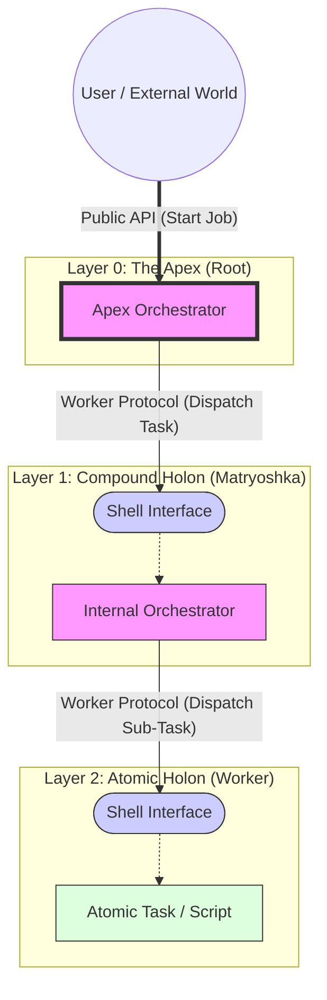

# Architecture: Shell-Stacked Holarchy

> **"We build Holarchies, not Hierarchies."**

**The net is vast and infinite.** To navigate this complexity without collapsing under cognitive load, we reject the fragile pyramid of traditional control. Instead, we adopt **Shell-Stacking** to construct resilient systems of autonomous entities.

## The Spectrum of Ghosts

A Ghost is the internal intelligence of a Holon. The Grid does not care how the Ghost is implemented, allowing for a spectrum of complexity and nature:

1.  **Atomic Ghost (The Task):** A single function, a script, or a legacy tool. It does one thing and has no subordinates. This is the "Simple Worker."
2.  **Physical Ghost (The Machine):** A hardware interface (Sensors, Actuators, PLCs). It connects the digital logic to physical matter.
3.  **Human Ghost (The Expert):** A person performing tasks via an interface. In HLN, human intuition and expertise are treated as specialized high-latency "Skills."
4.  **Compound Ghost (The Orchestrator):** A sovereign engine managing its own internal Holarchy. It doesn't perform tasks directly; it directs them. This is the "Matryoshka."

The **Shell** is the great equalizer. To the higher-level Grid, an **Atomic Holon**, a **Physical Holon**, a **Human Holon**, and a **Compound Holon** are indistinguishable. Each is a node that accepts commands and returns results.
This allows a system to start simple (atomic) and evolve into a complex holarchy (compound) without ever changing its external interface.

## The Apex

Every Holarchy must have a beginning. The **Apex** (or Root) is an Orchestrator that is **not encased in a Shell**.

*   It has no parent in the Grid.
*   It serves the **User** (The External World).
*   Its interface is the **Public API**, not the Worker Protocol.

The Apex is the "Prime Mover" that injects intent into the system, cascading commands down through layers of Compound Holons until they reach the Atomic Holons that perform the work.

## Shell-Stacking

Complexity is not managed by expanding the codebase, but by **stacking shells**.

**The Shell-Stacking Principle:**
*Any Orchestrator (Ghost) can be encased in a Worker Interface (Shell) to become a component of a higher-order Orchestrator.*

This creates a **Holarchy** — a hierarchy of self-regulating holons that function autonomously as wholes while simultaneously acting as dependent parts. The resulting structure is formally known as the **HLN (Holarchical Logic Network)**.

### The Metaphor: Ghost & Shell

*   **The Ghost (Blueprint/Engine):** The pure logic. The state machine. Without a shell, it is a disembodied process—capable of thought (state transitions) but incapable of connection.
*   **The Shell (Adapter/Bridge):** The mechanical body. It translates the raw intent of the Ghost into the standard protocol of the Grid (HLN Protocol).

```python
# The Ghost (Internal Logic)
# A complex, sovereign entity with its own database, rules, and memory.
internal_ghost = Orchestrator(blueprint="complex_ai_reasoning")

# The Shell (External Interface)
# Encasing the ghost makes it a Holon compatible with the grid.
# To the outside world, it looks just like a simple "resize_image" function.
holon = Shell(ghost=internal_ghost)

# Stacking
# The higher-level system connects to the Holon, unaware of the complexity within.
grid.connect(holon)
```

## RXON: The Nervous System

If the **Ghost** is the mind and the **Shell** is the body, then **RXON (Reverse Axon)** is the nervous system connecting the Holarchy.

In biology, an axon carries impulses away from the cell body (The Brain). In the HLN, we invert this connection setup to guarantee security and traversability:

*   **The Reverse Growth:** The subordinate Holon (The Muscle/Worker) initiates the connection ("grows the axon") towards the superior Holon (The Brain/Orchestrator).
*   **The Signal:** Once established, the command signal flows "downstream" (from Brain to Muscle) as usual.

This **Reverse Axon** architecture ensures that the Brain never needs to know the location of the Muscle; the Muscle finds the Brain.

## Why Holarchies?

### 1. Autonomy & Resilience
In a standard hierarchy, if the brain dies, the limbs rot. In a Holarchy, if the link to the higher level is severed, the Holon continues to function internally. The Ghost remains intact within the Shell, preserving its state and waiting for a new connection.

### 2. Infinite Recursion
The pattern is isomorphic at all scales.
*   **Layer 0:** A Python function (Atomic Ghost).
*   **Layer 1:** A Worker script wrapping that function (Atomic Holon).
*   **Layer 2:** An Orchestrator managing a fleet of Layer 1 Workers (Compound Ghost).
*   **Layer 3:** A Bridge wrapping Layer 2 (Compound Holon).
*   **Layer 4:** An Enterprise Grid managing Layer 3 Holons...

### 3. Evolutionary Replacement
You can swap the internal Ghost (upgrade the logic from a script to a neural network to a human operator) without changing the external Shell (the contract). The Grid doesn't care what's inside the Shell, as long as it speaks the Protocol.

---

*The geometry of HLN is fractal, but the philosophy is Holarchic: every node is at once a whole and a part.*

## Visualizing the Holarchy



