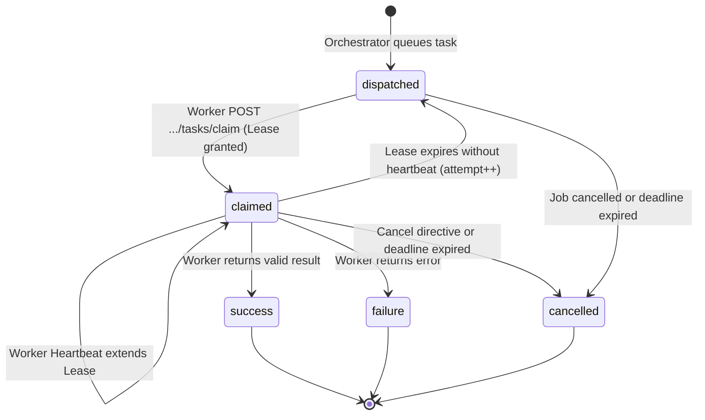

# HLN Lifecycle, Statuses & FSM Transitions

**Status:** Normative Standard  
**Editor:** Dmitry Gagarin (madgagarin)  
**Conformance:** RFC 2119 / RFC 8174  

---

## 1. Scope

This document specifies the normative status sets, transition state machines, terminal conditions, and quarantine semantics for Jobs, Tasks, and Workers across the Holarchical Logic Network (HLN).

---

## 2. Job Lifecycle & FSM Statuses

A Job represents an instantiated execution of a Blueprint. Every Job exists in exactly one status at any point in time:

| Job Status | Category | Description | Permitted Next Statuses |
|---|---|---|---|
| `pending` | Initial | Job accepted by API, allocated resources, awaiting initial start step. | `running`, `cancelled` |
| `running` | Active | FSM currently evaluating a step, local handler, or decider. | `waiting_for_worker`, `waiting_for_parallel_tasks`, `waiting_for_human`, `finished`, `failed`, `quarantined`, `cancelled` |
| `waiting_for_worker` | Suspended | Task dispatched to worker queue, awaiting claim or result. | `running`, `failed`, `quarantined`, `cancelled` |
| `waiting_for_parallel_tasks` | Suspended | Concurrent sub-tasks dispatched in parallel branch. | `running`, `failed`, `quarantined`, `cancelled` |
| `waiting_for_human` | Suspended | Execution blocked awaiting human approval via webhook callback. | `running`, `cancelled` |
| `finished` | Terminal | Job successfully concluded at an `@bp.end` state with validated output. | *(None — Terminal)* |
| `failed` | Terminal | Step or skill failed and no `on_failure` transition was declared. | *(None — Terminal)* |
| `error` | Terminal | System-level failure (storage error, network fault, internal exception). | *(None — Terminal)* |
| `quarantined` | Terminal / Forensic | Frozen due to security violation, replay, tamper, or limit breach. | *(None — Terminal)* |
| `cancelled` | Terminal | Explicitly cancelled by user, parent holon, or deadline expiration. | *(None — Terminal)* |

### Terminal States Set
Compliant implementations **MUST** define `TERMINAL_STATES` as:
$$\text{TERMINAL\_STATES} = \{\text{finished},\ \text{failed},\ \text{error},\ \text{quarantined},\ \text{cancelled}\}$$
Once a Job enters any terminal status, its state becomes immutable; further task results or worker events for this job **MUST** be rejected with HTTP `410 Gone`.

### Quarantine Semantics
A Job **MUST** transition immediately to `quarantined` when any of the following conditions is detected:
1. **Policy Violation:** Attempt to dispatch a skill not in `policy.allowed_skills`.
2. **Depth Limit Exceeded:** A child sub-job is spawned with `holarchy_depth > max_holarchy_depth`.
3. **Transition Limit Exceeded:** `transition_count > MAX_TRANSITIONS_PER_JOB` (default: 50).
4. **State Tampering:** Job state HMAC verification failure upon read from storage.
5. **D-DNA Audit Break:** Event chain hash discrepancy during history verification.
6. **Unhandled Middleware Exception:** Failure during security airlock processing.

---

## 3. Task Lifecycle & FSM Statuses

A Task is an atomic unit of work dispatched to a Worker:

| Task Status | Description |
|---|---|
| `dispatched` | Task enqueued, awaiting claim by an eligible worker. |
| `claimed` | Worker has claimed the task under a temporary lease (`lease_ttl_s`). |
| `success` | Worker successfully completed the task; data validated against `output_schema`. |
| `failure` | Worker reported failure with structured `TaskError`. |
| `cancelled` | Task interrupted via cooperative cancellation or deadline expiration. |

---

## 4. Worker Lifecycle & Registration Statuses

| Worker Status | Description |
|---|---|
| `active` | Worker registered, heartbeating, and actively eligible for task claims. |
| `draining` | Worker completing in-flight tasks but excluded from receiving new claims (graceful shutdown). |
| `offline` | Heartbeat interval expired without renewal; active tasks reassigned via fencing increment. |
