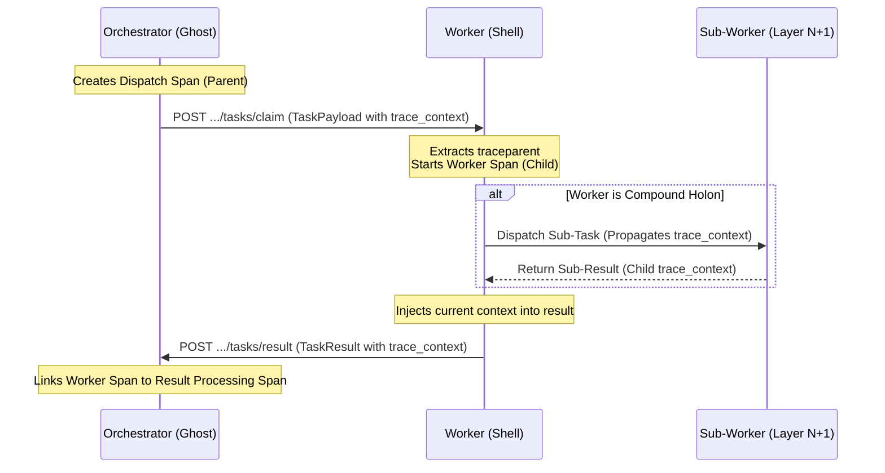

# Distributed Tracing Protocol (Orchestrator ↔ Worker)

**Status:** Normative Standard  
**Editor:** Dmitry Gagarin (madgagarin)  
**Conformance:** RFC 2119 / RFC 8174  
**Standard Reference:** W3C Trace Context (Level 1) / OpenTelemetry  

---

## 1. Scope & Purpose

This document defines the normative end-to-end telemetry propagation protocol between Orchestrators and Workers across all layers of the Holarchy using the RXON protocol and OpenTelemetry standards.

Compliant implementations **MUST** propagate distributed context across network boundaries to preserve end-to-end causality, latency profiling, and root-cause analysis across Compound Holons and deep execution hierarchies.

---

## 2. Context Field Specification

### 2.1. Canonical Field Name: `trace_context`
- The canonical field name across all messages (`TaskPayload`, `TaskResult`, `WorkerEventPayload`) **MUST** be **`trace_context`** (a JSON dictionary).
- **Backward Compatibility:** Orchestrators and workers **SHOULD** accept `tracing_context` as a deprecated fallback alias when receiving messages from older runtimes. Outbound messages generated by compliant implementations **MUST** emit `trace_context`.

### 2.2. Content Format
The `trace_context` dictionary **MUST** contain W3C Trace Context key-value string pairs:
- **`traceparent` (REQUIRED):** Formatted as `00-{trace_id}-{span_id}-{trace_flags}` per W3C specification (e.g., `00-4bf92f3577b34da6a3ce929d0e0e4736-00f067aa0ba902b7-01`).
- **`tracestate` (OPTIONAL):** Vendor-specific opaque routing tags.

---

## 3. Propagation Lifecycle

### Step 1: Task Dispatch (Orchestrator)
1. When dispatching a task, the Orchestrator **MUST** create a child span representing the task dispatch operation.
2. It uses the OpenTelemetry `TextMapPropagator` to inject the span context into `TaskPayload.trace_context`.
3. If OpenTelemetry is disabled, `trace_context` **MAY** be omitted or empty.

### Step 2: Task Execution (Worker)
1. Upon claiming a task, the Worker inspects `TaskPayload.trace_context`.
2. If present and OpenTelemetry is active, the Worker **MUST** extract the context and initialize its execution span as a direct child of the Orchestrator's dispatch span.
3. If absent or telemetry is disabled, the Worker executes normally without telemetry overhead.

### Step 3: Result Submission (Worker)
1. Upon completing task execution, the Worker injects its active span context into `TaskResult.trace_context`.
2. For compound workers that spawned sub-jobs, the trace preserves the full call tree across the nesting hierarchy.

### Step 4: Worker Events (Signals)
1. When a worker emits a `WorkerEventPayload`, it **MUST** inject its active span context into `WorkerEventPayload.trace_context`.
2. As the event bubbles up through intermediate Compound Holons, `trace_context` **MUST** be preserved intact to maintain trace continuity in distributed viewers (e.g., Jaeger, OpenSearch).

---

## 4. Graceful Degradation & Non-Interference

1. **Zero-Friction Fallback:** The absence of telemetry libraries or invalid `traceparent` headers **MUST NOT** disrupt task execution. Non-compliant trace headers **MUST** be silently discarded without generating application-level errors.
2. **Security Isolation:** `trace_context` is non-authoritative diagnostic metadata and **MUST NOT** be relied upon for authentication, authorization, or billing decisions.
