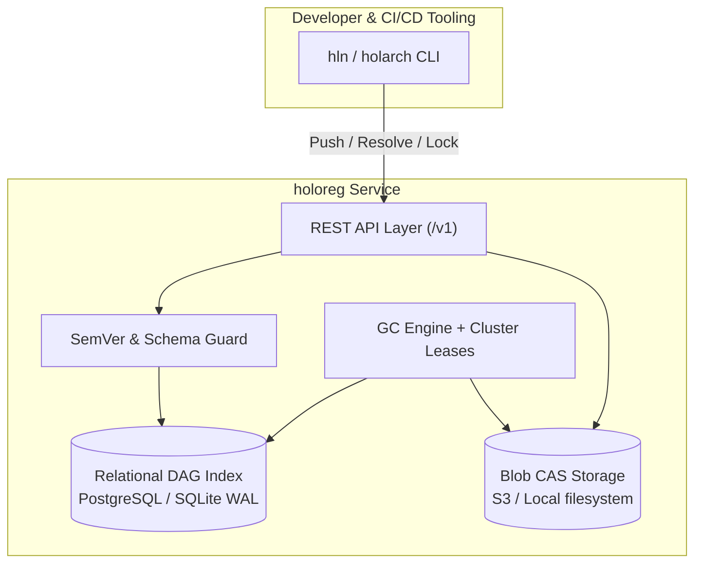

# HoloReg: CAS Storage & Merkle DAG Registry Specification

**Status:** Normative Standard  
**Editor:** Dmitry Gagarin (madgagarin)  
**Conformance:** RFC 2119 / RFC 8174  
**Compatibility:** OCI v1.1 Image & Referrers Specification  

---

## 1. Architectural Overview

`holoreg` provides centralized Content-Addressable Storage (CAS) and an immutable Merkle Directed Acyclic Graph (DAG) registry for skills, composite blueprints, execution bundles, and environment lockfiles.



---

## 2. Content-Addressable Storage (CAS) Layout

Every artifact, bundle, environment file, and model weight is addressed strictly by the hex-encoded SHA-256 digest of its contents.

### 2.1. File Hierarchy
```text
blobs/sha256/{digest[0:2]}/{digest}
```
* Example: `blobs/sha256/7f/7f83b1657ff1fc53b92dc18148a1d65dfc2d4b1fa3d677284addd200126d9069`

### 2.2. Standard Media Types
* `application/vnd.holarchy.manifest.v1+json`: Canonical JSON of release manifest.
* `application/vnd.holarchy.skill.bundle.v1.tar+zstd`: Deterministic `.tar.zst` archive containing skill implementation code.
* `application/vnd.holarchy.skill.env.v1+lock`: Environment lockfile (`uv.lock`).
* `application/vnd.holarchy.blueprint.graph.v1+json`: Declarative execution graph compiled from Blueprint DSL.
* `application/vnd.holarchy.asset.model.v1+octet-stream`: Deduplicated binary model weights (`.safetensors`, `.gguf`, `.onnx`).

---

## 3. Relational Merkle DAG Schema

The registry maintains relational integrity and reference counts over published manifests and physical blobs:

### 3.1. Core Entities
1. **`holoreg_namespaces`**: Owners, public keys, and namespace administrative boundaries.
2. **`holoreg_api_tokens`**: Bearer tokens with fine-grained scopes (`push`, `pull`, `yank`, `admin`).
3. **`holoreg_repositories`**: Repository containers (`kind IN ('skill', 'blueprint')`, `execution_mode IN ('portable', 'blackbox')`).
4. **`holoreg_blobs`**: Physical CAS blobs tracking `ref_count` and storage location.
5. **`holoreg_upload_sessions`**: Ephemeral sessions preventing garbage-collection race conditions during multi-part chunk uploads.
6. **`holoreg_manifests`**: Vertices of the Merkle DAG holding canonical versions, contract schemas, implementation digests, and signatures.
7. **`holoreg_refs`**: Branch heads (`heads/main`) and immutable release tags (`tags/v1.4.2`).
8. **`holoreg_graph_edges`**: Explicit directed edges representing composition:
   * `blueprint_uses_skill`
   * `blueprint_uses_blueprint`
   * `holon_uses_bundle_blob`
   * `holon_uses_env_blob`
   * `holon_uses_asset_blob`
9. **`holoreg_cluster_leases`**: Active cluster registrations protecting running workloads from garbage collection.

---

## 4. HTTP REST API Specification

### 4.1. Authentication
* `POST /v1/auth/tokens`: Issue scoped API token via signed cryptographic challenge.
* Header: `Authorization: Bearer <token_secret>`

### 4.2. Upload Sessions & Blob Ingestion
* `POST /v1/upload-sessions/start`
  * Request:
    ```json
    {
      "repo_path": "vision/ocr-fast",
      "required_digests": ["sha256:7f83b165..."]
    }
    ```
  * Response: List of missing digests requiring upload and pre-signed upload URLs.
* `PUT /v1/blobs/{digest}`: Stream bytes with SHA-256 validation.
* `HEAD /v1/blobs/{digest}`: Verify blob presence and query `Content-Length`.
* `GET /v1/blobs/{digest}`: Stream blob contents (supports HTTP Range and Linux zero-copy `sendfile`).

### 4.3. Manifest Publication & SemVer Gate
* `POST /v1/manifests/{namespace}/{name}`
  * Verifies namespace authorization token.
  * Checks that all required blob digests exist in CAS.
  * **SemVer Gate:** If a previous version exists in `holoreg_manifests`, compares `input_schema` and `output_schema` using `rxon.schema.is_schema_compatible`:
    * If contract compatibility rules are violated for a minor/patch version release, the registry MUST reject publication with HTTP 409 Conflict and an actionable breaking change report.
  * Atomically records manifest, graph edges, and tag references.

### 4.4. Resolution & Referrers API (OCI v1.1)
* `GET /v1/resolve?repo=vision/ocr-fast&version=^1.4`: Resolves SemVer range into optimal unyanked canonical version and digest.
* `GET /v1/manifests/{namespace}/{name}/{reference}`: Fetches manifest by tag, branch, or digest.
* `GET /v1/manifests/{digest}/referrers?artifactType=application/spdx+json`: Returns attached supply-chain metadata (SBOMs, SLSA Level 3 attestations, SAR audit reports).
* `POST /v1/manifests/{namespace}/{name}/{version}/yank`: Marks version as yanked without deleting data (existing locks continue to work; new resolutions ignore it).

### 4.5. Cluster Leases & Garbage Collection
* `POST /v1/leases/heartbeat`
  * Body: `{"cluster_id": "orchestrator-prod-1", "manifest_digests": ["sha256:abc...", ...], "ttl_s": 3600}`
  * Renews cluster lease expiration.
* **GC Invariant:** A blob or manifest is eligible for pruning ONLY if:
  1. `ref_count == 0` (no manifest references it).
  2. No active upload session reserves it (`expires_at < now`).
  3. No active cluster lease protects it (`expires_at < now`).
