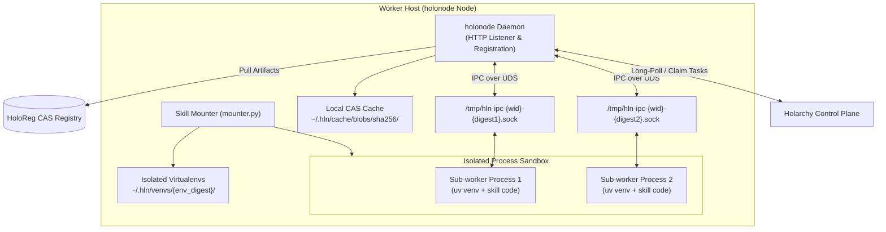

# HoloNode: Dynamic Worker Runtime & Isolation Specification

**Status:** Normative Standard  
**Editor:** Dmitry Gagarin (madgagarin)  
**Conformance:** RFC 2119 / RFC 8174  
**Isolation Model:** Isolated Sub-workers via Unix Domain Sockets (UDS) & Python venv  

---

## 1. Runtime Architecture

`holonode` is the decentralized execution node responsible for acquiring, verifying, and executing skills dispatched by the orchestrator.



---

## 2. Dynamic Skill Mounting Workflow (`mounter.py`)

When directed by the orchestrator via the heartbeat synchronization channel (`mount_digests`):

1. **Artifact Acquisition & Verification:**
   * Fetch manifest and required blobs (`bundle.tar.zst`, `uv.lock`, weights) from `holoreg` into `~/.hln/cache/blobs/sha256/`.
   * Verify SHA-256 integrity against the manifest digests before touching disk.
2. **Atomic Unpacking & Symlinks:**
   * Extract bundle into `~/.hln/mounted/{manifest_digest}/`.
   * Create atomic symlinks from cache for large asset weights (`tmp` + atomic POSIX `rename`).
3. **Environment Isolation (`uv venv`):**
   * For driver `native:python:venv`, instantiate an isolated virtual environment at `~/.hln/venvs/{env_digest}/` using `uv venv` and `uv sync --frozen`.
   * Multiple skills with conflicting library dependencies (e.g. `numpy 1.x` vs `numpy 2.x`, different CUDA bindings) execute in separate venvs without interference.
4. **Sub-worker IPC via Unix Domain Sockets:**
   * Spawn sub-worker process using the dedicated venv interpreter:
     ```bash
     ~/.hln/venvs/{env_digest}/bin/python -m holonode.subworker --socket /tmp/hln-ipc-{wid}-{digest}.sock
     ```
   * Fast, zero-copy local IPC prevents port exhaustion and eliminates network exposure.
5. **Orchestrator Registration:**
   * Node notifies orchestrator of the newly available skill with canonical name (e.g. `vision/ocr-fast`) and canonical pinned version `1.4.2+sha256.bbb222098fc1`.

---

## 3. Pull-Based Skill Synchronization (Heartbeat Control Channel)

Worker nodes **do not expose inbound HTTP management or control endpoints** (eliminating network exposure and port management issues). Only an optional local healthcheck probe (`GET /health`) may be exposed for readiness/liveness checks.

### 3.1. Pull-Based Control Protocol
1. **Heartbeat Reporting:**
   * Periodically (e.g. every 5–15 seconds), the worker sends an authenticated `PATCH /_worker/workers/{worker_id}` request to the Holarchy Orchestrator.
   * The request payload includes the set of currently mounted manifest digests in `mounted_manifests: list[str]`.
2. **Orchestrator Reconciliation:**
   * The Orchestrator compares `mounted_manifests` with the desired skill manifests assigned to that worker.
   * If discrepancies exist, the Orchestrator's heartbeat response instructs the worker with diff actions:
     * `mount_digests: list[str]` — manifests that must be downloaded and mounted.
     * `unmount_digests: list[str]` — manifests that must be drained and unloaded.
3. **Worker Lifecycle Handling:**
   * On receiving `mount_digests`, the worker pulls the required blobs from HoloReg CAS and mounts the skills locally.
   * On receiving `unmount_digests`, the worker gracefully drains in-flight tasks and shuts down the associated subworker processes.
   * On disconnect or heartbeat loss, the worker enforces its configured `orphan_policy` (`continue` or `abort`).

---

## 4. Supply Chain Security & Attestation

Before mounting artifacts in Profile L2 environments:
* **SBOM Inspection:** Node verifies Software Bill of Materials (CycloneDX / SPDX) attached via Referrers API.
* **SLSA Provenance:** Node validates SLSA Level 3 build attestations to ensure binaries originate from authenticated CI/CD builders.
